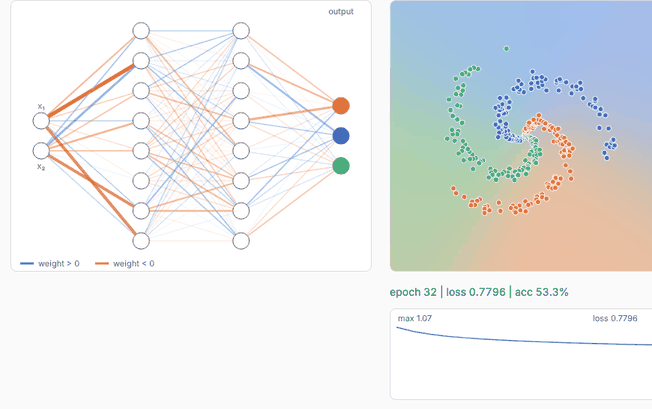
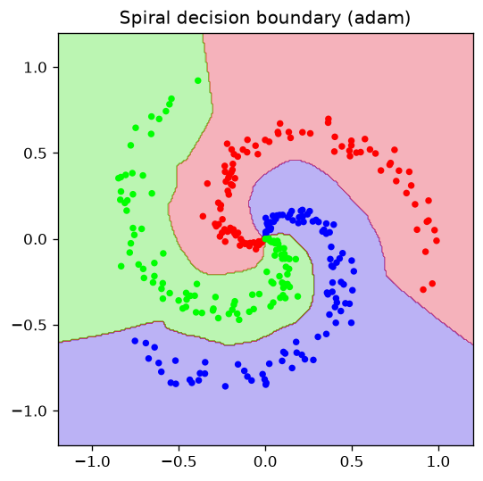
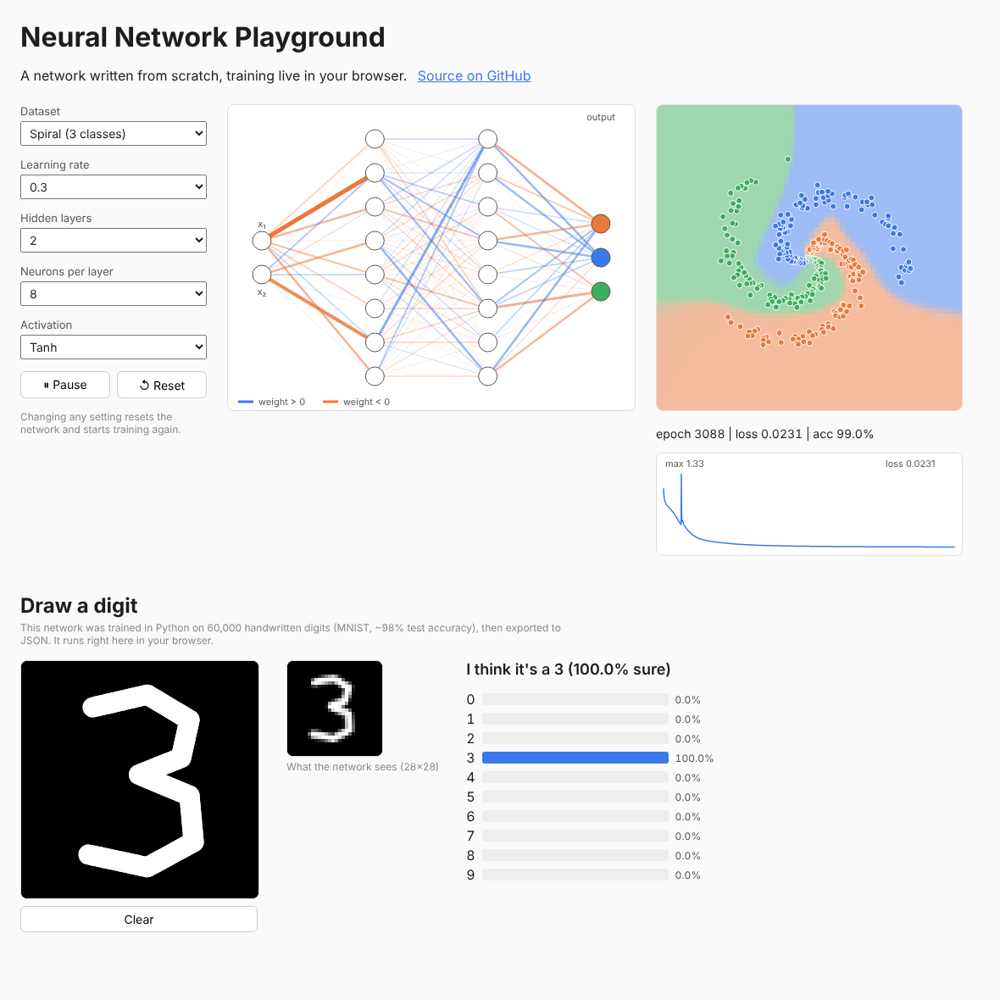

# nn-from-scratch

[](https://github.com/anpaan/nn-from-scratch/actions/workflows/ci.yml)

A neural network engine written from scratch with **NumPy only** (no PyTorch, no TensorFlow), plus an interactive **browser playground** where you can watch a network learn in real time and draw digits for it to recognise.

### ▶ [Try the playground](https://anpaan.github.io/nn-from-scratch/)



## What's inside

| Part | What it is |
|---|---|
| `engine/` | Linear layer, ReLU / Sigmoid / Tanh, MSE and Softmax cross-entropy, SGD and Adam, all with hand-written backpropagation |
| `tests/` | Numerical gradient checks for every layer and loss, optimizer tests, end-to-end training tests |
| `examples/` | XOR, 3-class spiral (with decision-boundary plot), MNIST digit recognition |
| `scripts/` | Download MNIST, export trained weights to JSON for the browser |
| `playground/` | TypeScript re-implementation of the engine + live visualisation: decision boundary, network graph, loss curve, draw-a-digit |
| `docs/notes.md` | My study notes on the fundamentals, and an experiment log (Vietnamese) |

## Results

| Task | Network | Result |
|---|---|---|
| XOR | 2 → 8 → Tanh → 2, SGD | 4/4 correct |
| Spiral, 3 classes | 2 → 64 → ReLU → 64 → ReLU → 3, Adam | 99.3% accuracy (Adam reaches 98% in 50 epochs, SGD needs ~300) |
| MNIST | 784 → 128 → ReLU → 10, Adam, mini-batch 64 | **97.7%** test accuracy after 5 epochs, 98.1% after 50 |

Spiral decision boundary, trained with the Python engine:



The playground, with the MNIST network (trained in Python, exported to JSON) running in the browser:



## Quick start

Python engine:

```bash
python -m venv .venv
source .venv/bin/activate        # Windows: .venv\Scripts\Activate.ps1
pip install -r requirements.txt
python -m pytest -v              # gradient checks and training tests
python -m examples.xor           # train your first network
python -m examples.spiral        # writes docs/spiral.png (add --opt sgd to compare)
python -m scripts.download_mnist
python -m examples.mnist         # ~98% in a few epochs
```

Playground:

```bash
cd playground
npm install
npm run dev                      # http://localhost:5173/nn-from-scratch/
npm test                         # gradient checks for the TypeScript engine
```

## What I learned

I work on embedded systems (C, STM32, Raspberry Pi, CAN), so this was my first real step into machine learning. Things that clicked for me:

- **Backpropagation is just the chain rule, passed backwards like a fault report.** Each layer only needs the gradient coming from the layer after it. Seen this way, it felt a lot like gains in series in a signal chain.
- **Silent bugs are the dangerous ones.** If a layer writes its gradient into a *new* array instead of the existing one, every gradient test still passes but the network never learns, because the optimizer holds references to the old arrays. Same idea as writing to `p` instead of `*p` in C.
- **Activation functions are what make depth useful.** Without them, stacked linear layers collapse into one linear function: on XOR the loss gets stuck at exactly ln 2, the network just guesses 50/50.
- **The learning rate behaves like a controller gain.** Too high and training overshoots, then saturates Tanh and gets stuck; too low and it barely moves.
- **Adam's per-parameter step size matters more than momentum** on the spiral: turning momentum off barely changed the speed.
- **Overfitting is easy to see.** On MNIST the training accuracy reaches 100% while test accuracy flattens around 98% after ~10 epochs. The extra epochs only memorise the training set.
- **Data at inference time must look like training data.** The draw-a-digit demo only works because the drawing is cropped, scaled to 20 px and centred by its centre of mass, exactly like MNIST.

Built as a learning project, with Claude (Anthropic) as tutor and pair programmer.

## License

MIT
